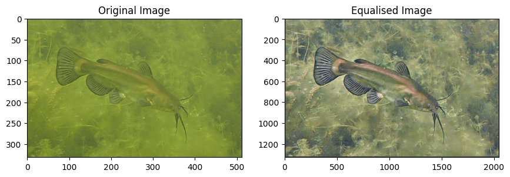

# SEAING-CLEARLY — Underwater Image Enhancement Pipeline

Backend image-processing research and enhancement pipeline for **SEAING-CLEARLY**, a University of the Sunshine Coast (ICT342, 2024) group project to improve the clarity of underwater photos and video frames.



## My role

SEAING-CLEARLY was a team project; **I designed and wrote all of the backend image-enhancement code in this repository**, from filter evaluation and super-resolution benchmarking through to the final enhancement pipeline integrated into the delivered application.

## Final enhancement pipeline (`Filters_Final.ipynb`)

The selected four-stage pipeline processes an input image sequentially using OpenCV, NumPy, and scikit-image:

1. **LAB colour-space white balance** — Shifts the `a` and `b` chromaticity channels toward neutral weighted by luminance to counteract underwater blue/green colour cast.
2. **Deep-learning super-resolution (`EDSR_x4`)** — Upscales the colour-corrected image 4x using OpenCV's `dnn_superres` module (the repo also includes `EDSR`, `ESPCN`, `FSRCNN`, and `LapSRN` pre-trained `.pb` models tested for speed vs quality trade-offs).
3. **Richardson-Lucy deconvolution** — Applies iterative per-channel deconvolution (`scikit-image`, 5x5 uniform PSF, 30 iterations) to sharpen underwater blur.
4. **Adaptive histogram equalisation (CLAHE)** — Applies `skimage.exposure.equalize_adapthist` (`clip_limit=0.01`) per channel to recover local contrast without over-amplifying noise.

## Repository contents

| Path | Description |
|---|---|
| `Filters_Final.ipynb` | Final four-stage enhancement pipeline with side-by-side stage comparisons on the bundled sample images |
| `Test_1_Main.ipynb` | Exploratory benchmarks covering wavelet noise estimation (`estimate_sigma`), gamma correction, CLAHE, Non-Local Means and bilateral denoising, Wiener-Hunt vs Richardson-Lucy deconvolution, Sobel/Scharr/Canny edge detection, SLIC segmentation, OpenCV super-resolution models, and initial YOLOv8 marine-species detection experiments |
| `underwater1.jpg` – `underwater3.jpg` | Sample underwater test images |
| `*.pb` | Pre-trained OpenCV super-resolution weights (`EDSR`, `ESPCN`, `FSRCNN`, `LapSRN`) |
| `requirements.txt` | Python dependencies |

## Running locally

```bash
pip install -r requirements.txt
jupyter notebook Filters_Final.ipynb
```

For the optional Roboflow inference cells in `Test_1_Main.ipynb`, set `ROBOFLOW_API_KEY` in your environment before running.

## Tech stack

Python, OpenCV (`opencv-contrib-python` / `dnn_superres`), scikit-image, NumPy, SciPy, Matplotlib, Ultralytics YOLOv8.
